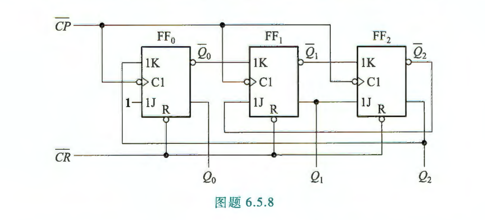
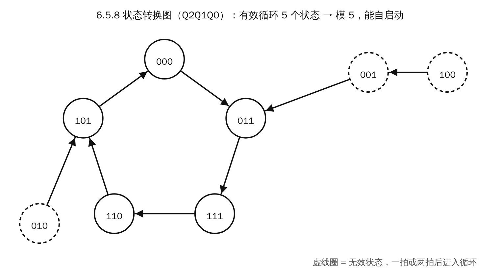
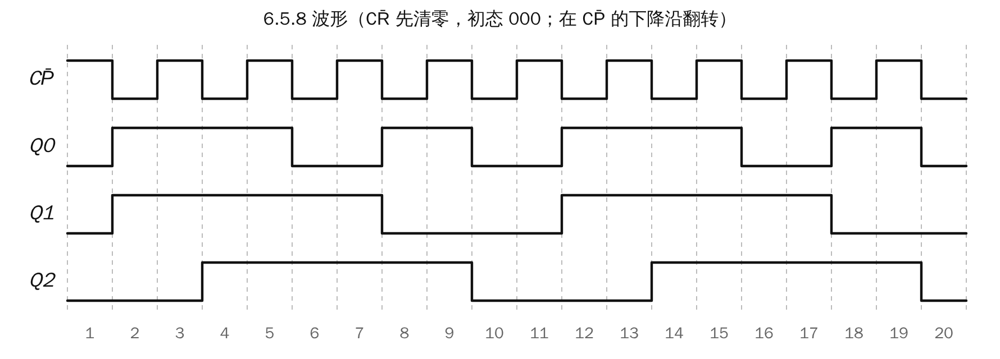
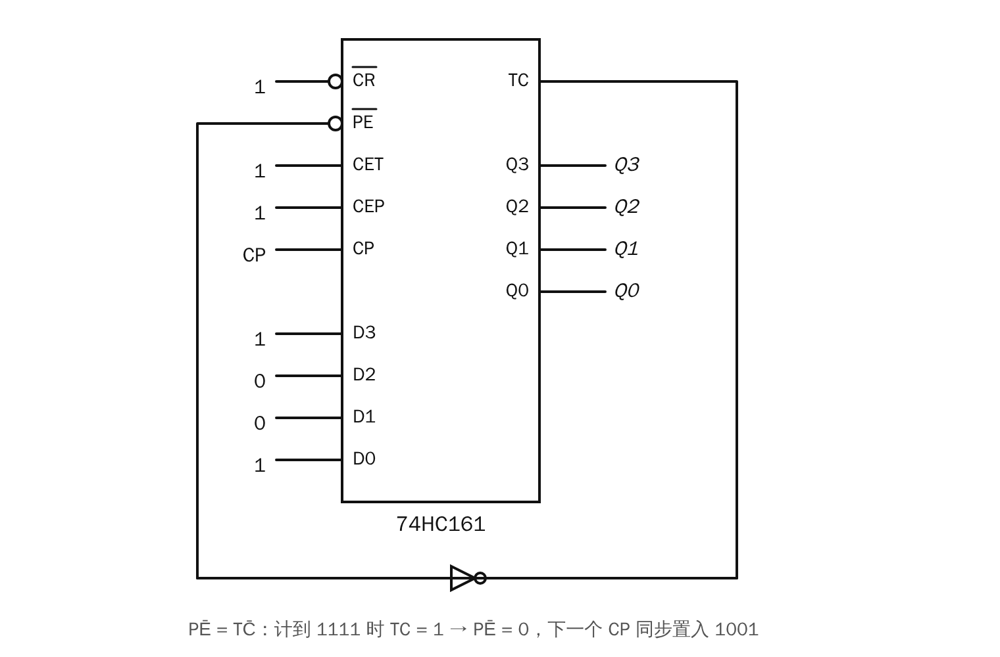
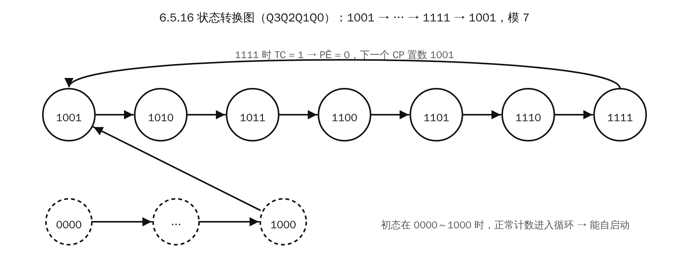
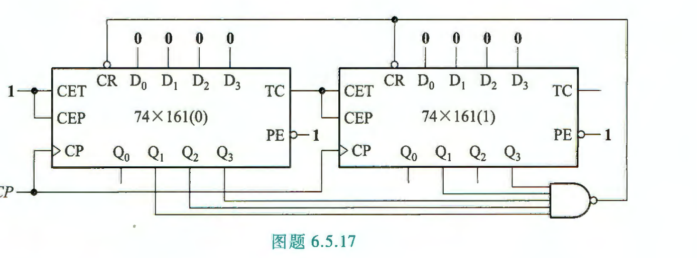
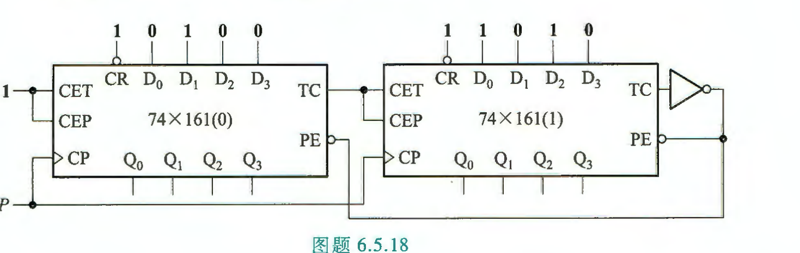
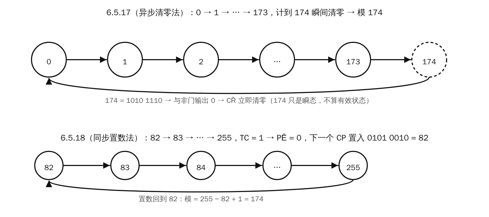

# 习题 6.5 计数器：题目与解答

> 出处：《电子技术基础（数字部分）》习题 6.5 节，P327–329。对应课件 18。
> ⚠️ 课件 18 **不在期中考试范围**（期中考 PPT 01–08、10–14）。

---

## 6.5.8

**题目：** 试分析图题 6.5.8 所示计数器的模，画出各触发器输出端的波形图。

**解答：**

**① 判断类型。** 三个触发器的 C1 都接 $\overline{CP}$，所以是**同步**电路，在 $\overline{CP}$ 的下降沿翻转。$\overline{CR}$ 是公共的异步清零端。

**② 驱动方程：**

$$J_0=1,\quad K_0=Q_2$$
$$J_1=\overline{Q_2},\quad K_1=\overline{Q_0}$$
$$J_2=Q_1,\quad K_2=\overline{Q_1}$$

**③ 状态方程。** 代入 JK 触发器的特性方程 $Q^{n+1}=J\overline{Q^n}+\overline{K}Q^n$：

$$Q_0^{n+1}=\overline{Q_0}+\overline{Q_2}\,Q_0=\overline{Q_0}+\overline{Q_2}$$
$$Q_1^{n+1}=\overline{Q_2}\,\overline{Q_1}+Q_0Q_1$$
$$Q_2^{n+1}=Q_1\overline{Q_2}+Q_1Q_2=Q_1$$

**④ 状态表**（$Q_2Q_1Q_0$）：

| 现态 | 000 | 001 | 010 | 011 | 100 | 101 | 110 | 111 |
|---|---|---|---|---|---|---|---|---|
| 次态 | 011 | 011 | 101 | 111 | 001 | 000 | 101 | 110 |

**⑤ 结论：**

- 有效循环为 $000\to011\to111\to110\to101\to000$，共 5 个状态，所以是**模 5**。
- 无效状态 001、010、100 都能在一到两拍内进入循环，所以**能自启动**。

**⑥ 波形图**（$\overline{CR}$ 先清零，从 000 开始）：

---

## 6.5.16

**题目：** 试用 74HC161 设计一个计数器，其计数序列以自然二进制数 1001～1111 顺序循环。

**解答：**（同步置数法，模 7）

**① 思路。** 一共 7 个状态，从 1001 计到 1111。计到 1111 时让芯片同步置入 1001。

**② 接线：**

- $\overline{CR}=1$，不用清零；$CET=CEP=1$，一直计数；
- 置数输入 $D_3D_2D_1D_0=1001$；
- $\overline{PE}=\overline{TC}$，即 TC 经反相器接到 $\overline{PE}$。也可以用 $\overline{PE}=\overline{Q_3Q_2Q_1Q_0}$。

**③ 工作过程：**

- 计到 1111 时 $TC=1$，所以 $\overline{PE}=0$；
- 下一个 CP 上升沿同步置入 1001；
- 循环为 $1001\to1010\to1011\to1100\to1101\to1110\to1111\to1001$，共 7 个状态。

**④ 自启动。** 如果初态是 0000～1000，电路正常向上计数，到 1001 后就进入循环，所以能自启动。

---

## 6.5.17

**题目：** 试分析图题 6.5.17 所示计数器，确定它的模。

**解答：**（异步清零法，模 174）

**① 级联方式。**

- 两片共用 CP，片(0) 的 TC 接片(1) 的 CET 和 CEP，构成 8 位**同步**二进制计数器。
- 两片的 D 端都接 0，$\overline{PE}=1$，所以不置数。

**② 与非门的输入：** 片(1) 的 $Q_3$、$Q_1$，片(0) 的 $Q_3$、$Q_2$、$Q_1$。

**③ 何时清零。** 这 5 个输出同时为 1 时，与非门输出 0：

- 高 4 位 $=1010$，低 4 位 $=1110$；
- 合起来是 $(1010\,1110)_2=160+14=174$。

**④ 结论。**

- 与非门输出接两片的 $\overline{CR}$，是**异步**清零。计到 174 时立即清零，所以 174 只是瞬态。
- 有效状态为 0～173，**模 174**。

---

## 6.5.18

**题目：** 试分析图题 6.5.18 所示计数器，确定它的模。

**解答：**（同步置数法，模 174）

**① 置数值。**

- 片(0)：$D_3D_2D_1D_0=0010$；
- 片(1)：$D_3D_2D_1D_0=0101$；
- 合起来是 $(0101\,0010)_2=82$。
- ⚠️ 图上从左到右的顺序是 $D_0D_1D_2D_3$，$D_0$ 在最左边，别读反。

**② 什么时候置数。**

- 片(1) 的 TC 经反相器接两片的 $\overline{PE}$。
- $TC_1=CET_1\cdot Q_3Q_2Q_1Q_0^{(1)}$，而 $CET_1=TC_0$。所以只有计到 1111 1111（255）时 $TC_1=1$，此时 $\overline{PE}=0$。

**③ 结论。**

- 255 之后的下一个 CP **同步**置入 82，循环为 82～255。
- 模 $=255-82+1=174$。

> **对比：** 6.5.17 和 6.5.18 用两种方法实现了同一个模 174。
>
> - **清零法**检测 "**M 本身**"（174）。因为清零是异步的，状态 M 只是一瞬间。
> - **置数法**检测 "**最后一个有效状态**"（255）。因为置数是同步的，最后一个状态会完整保持一拍。
