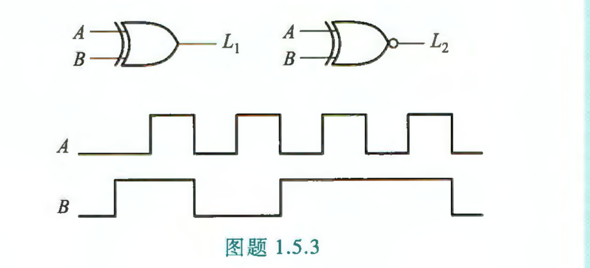
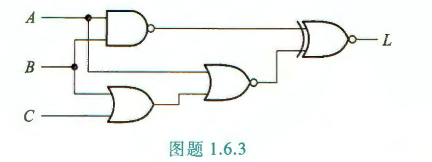
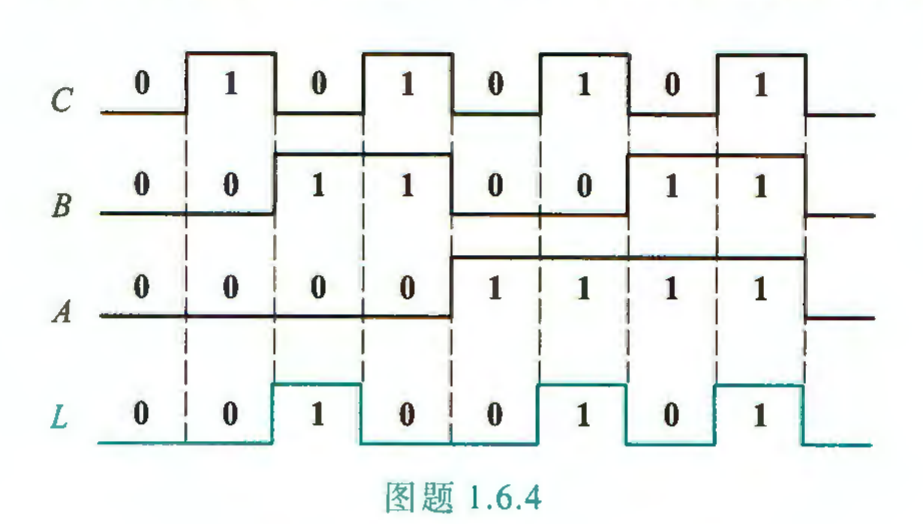

## Week02-Hw

作业内容：$T_{1.5.3,\,1.6.1,\,1.6.2,\,1.6.3,\,1.6.4,\,2.1.4,\,2.2.1(3),\,2.2.3(4)}$

- 9.8（第二周第一次）：P39–40：1.5.3、1.6.1、1.6.2、1.6.3、1.6.4；P74：2.1.4
- 9.10（第二周第二次）：P74：2.2.1(3)、2.2.3(4)
- 截止：9.17 23:59，BB 系统提交

#### 1.5 二值逻辑变量与基本逻辑运算

**1.5.3** 在图题 1.5.3 中，已知输入信号 $A$、$B$ 的波形，画出各逻辑门输出的波形。

$\textbf{sol:}$

#### 1.6 逻辑函数及其表示方法

**1.6.1** 已知逻辑函数的真值表如表题 1.6.1 所示，试写出其逻辑函数表达式。

| $A$ | $B$ | $C$ | $L$ |
|:---:|:---:|:---:|:---:|
| 0 | 0 | 0 | 1 |
| 0 | 0 | 1 | 0 |
| 0 | 1 | 0 | 0 |
| 0 | 1 | 1 | 1 |
| 1 | 0 | 0 | 0 |
| 1 | 0 | 1 | 1 |
| 1 | 1 | 0 | 0 |
| 1 | 1 | 1 | 0 |

$\textbf{sol:}$

**1.6.2** 已知逻辑函数 $L = A + \overline{B}C + \overline{A}B\overline{C}$，试求其对应的真值表。

$\textbf{sol:}$

**1.6.3** 已知逻辑图如图题 1.6.3 所示，试求 $L$ 的逻辑函数表达式。

$\textbf{sol:}$

**1.6.4** 已知逻辑函数 $L$ 的波形图如图题 1.6.4 所示，试求其真值表和逻辑函数表达式。

$\textbf{sol:}$

#### 2.1 逻辑代数的基本定律和规则

**2.1.4** 某逻辑函数的对偶式 $L' = \overline{\overline{A}B}\cdot\left(\overline{BC} + \overline{D}\right)$，则该逻辑函数 $L =$ ________，其反演式 $\overline{L} =$ ________。

$\textbf{sol:}$

#### 2.2 逻辑函数表达式的形式

**2.2.1** 将下列各式转换成与-或形式：

(3) $\overline{\overline{\overline{AC}\cdot\overline{BD}}\;\overline{\overline{BC}\cdot\overline{AB}}}$

$\textbf{sol:}$

**2.2.3** 试写出下列各个函数的最小项表达式。

(4) $L = \overline{\left(A\overline{B} + B\overline{C}\right)\overline{AB}}$

$\textbf{sol:}$
