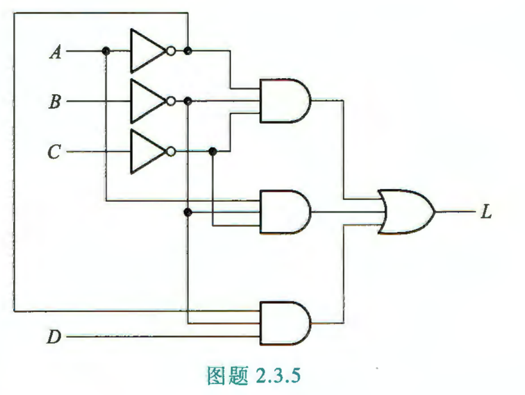
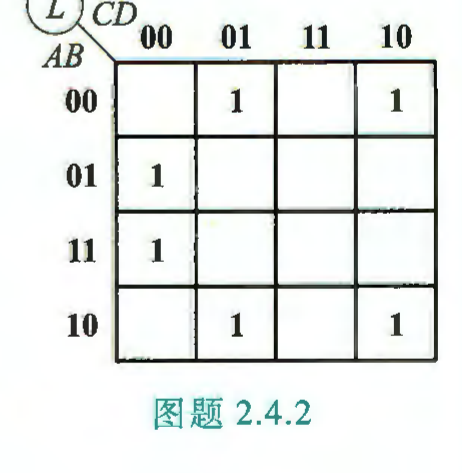
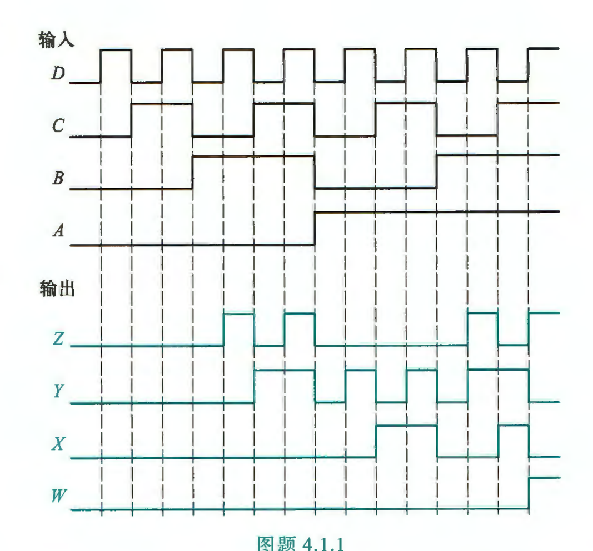

## Week03-Hw

作业内容：$T_{2.3.1(4),\,2.3.5,\,2.4.2,\,2.4.3(2)(4),\,4.1.1,\,4.2.1,\,4.2.3,\,4.2.14}$

- 9.15 布置：P74–75：2.3.1(4)、2.3.5、2.4.2、2.4.3(2)(4)；P206–209：4.1.1、4.2.1、4.2.3、4.2.14
- 截止：9.24

#### 2.3 逻辑函数的代数化简法

**2.3.1** 用代数法将下列各式化简成最简的与-或表达式：

(4) $\overline{\overline{AC+\overline{A}BC}+\overline{B}C+AB\overline{C}}$

$\textbf{sol:}$

**2.3.5** 写出图题 2.3.5 所示电路的逻辑表达式，将其转换成与非-与非表达式，然后画出仅用非门和与非门实现的逻辑图。

$\textbf{sol:}$

#### 2.4 逻辑函数的卡诺图化简法

**2.4.2** 已知函数 $L(A,B,C,D)$ 的卡诺图如图题 2.4.2 所示，试写出函数 $L$ 的最简与-或表达式。

$\textbf{sol:}$

**2.4.3** 用卡诺图法化简下列各式。

(2) $A\overline{B}CD+D\left(\overline{B}\,\overline{C}D\right)+(A+C)B\overline{D}+\overline{A}\,\overline{\left(\overline{B}+C\right)}$

$\textbf{sol:}$

(4) $L(A,B,C,D)=\sum m(0,4,6,13,14,15)+\sum d(1,2,3,5,7,9,10,11)$

$\textbf{sol:}$

#### 4.1 组合逻辑电路的分析

**4.1.1** 组合逻辑电路的输入波形（从高位到低位依次为 $ABCD$）及输出波形（从高位到低位依次为 $WXYZ$）如图题 4.1.1 所示，试分析电路的逻辑功能。

$\textbf{sol:}$

#### 4.2 组合逻辑电路的设计

**4.2.1** 设计一个 4 位二进制数表示的十进制数为素数的检测电路，当输入为素数时，输出为 1，否则输出为 0。写出其最小项逻辑表达式，并化简成最简与或表达式。

$\textbf{sol:}$

**4.2.3** 试设计一个 4 位的偶校验器，即当 4 位数中有偶数个 1（或没有 1）时输出为 1，否则输出为 0。采用异或门及非门实现。

$\textbf{sol:}$

**4.2.14** 设计一个电路，能实现表题 4.2.14 所示的逻辑功能，可以采用任何门电路来实现。化简变换时考虑多输出函数的公共乘积项，以减少门的数目。

| $A$ | $B$ | $C$ | $L_1$ | $L_2$ |
|:---:|:---:|:---:|:---:|:---:|
| 0 | 0 | 0 | 0 | 1 |
| 0 | 0 | 1 | 1 | 0 |
| 0 | 1 | 0 | 1 | 0 |
| 0 | 1 | 1 | 0 | 1 |
| 1 | 0 | 0 | 1 | 0 |
| 1 | 0 | 1 | 1 | 0 |
| 1 | 1 | 0 | 1 | 0 |
| 1 | 1 | 1 | 0 | 0 |

$\textbf{sol:}$
