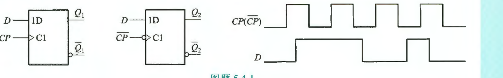
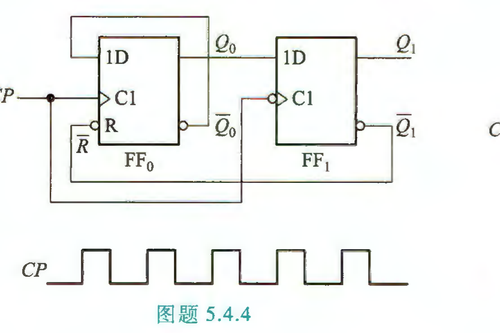
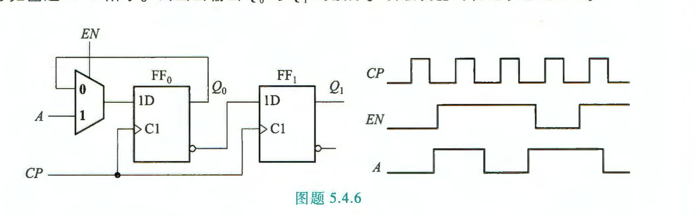
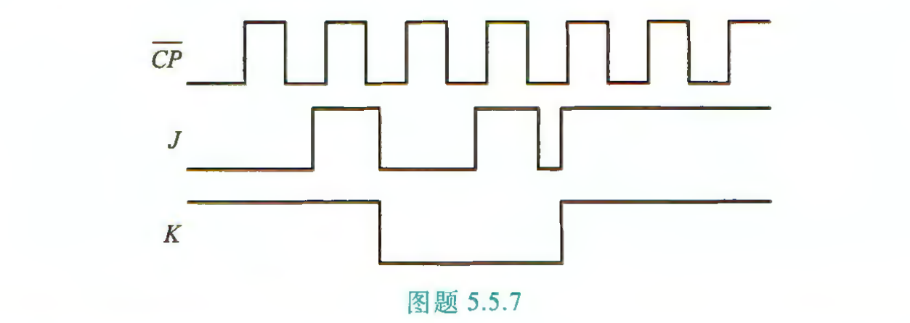
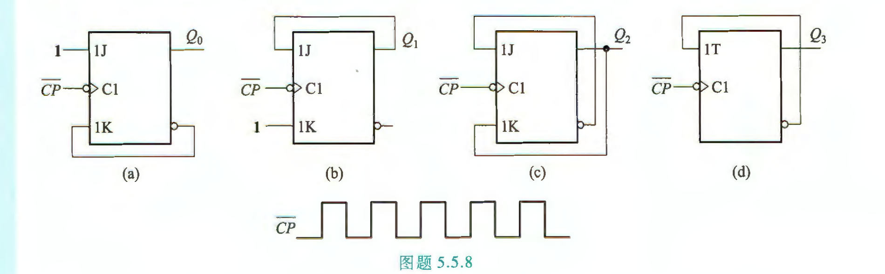
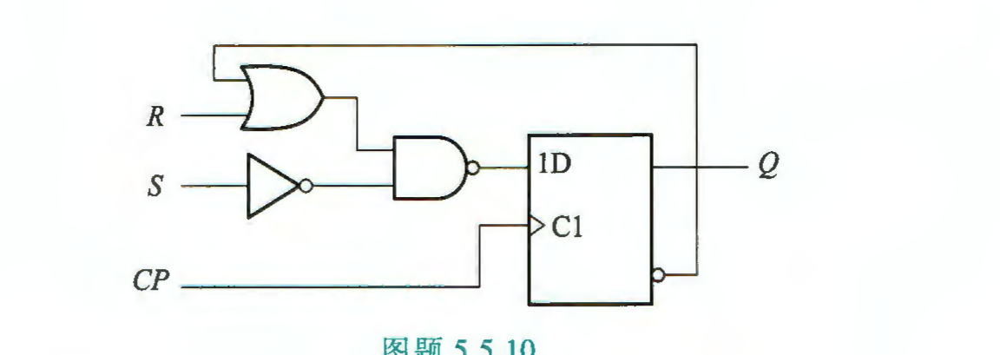

## Lesson12 触发器练习（课后习题 5.4 / 5.5）

练习内容：$T_{5.4.1,\,5.4.4,\,5.4.6,\,5.5.7,\,5.5.8,\,5.5.10}$

> 建议顺序：5.4.1 → 5.5.7 → 5.5.8 → 5.4.6 → 5.4.4 → 5.5.10，由易到难。
> 每道波形题都按"三步法"做：①找有效边沿画竖线 ②读竖线处的输入和现态 ③代特性方程。

#### 5.4 D 触发器

**5.4.1** 上升沿触发和下降沿触发的 $D$ 触发器逻辑符号及时钟信号 $CP(\overline{CP})$ 和输入信号 $D$ 的波形如图题 5.4.1 所示。分别画出它们的 $Q$ 端波形。设触发器的初始状态为 0。

$\textbf{sol:}$

**5.4.4** 由 $D$ 触发器构成的电路如图题 5.4.4 所示，$\overline{R}$ 为异步清零端。画出在时钟脉冲 $CP$ 作用下，输出端 $Q_0$ 和 $Q_1$ 的波形。设触发器的初始状态均为 0。

$\textbf{sol:}$

**5.4.6** 由 $D$ 触发器和数据选择器构成的电路，以及各个输入信号 $EN$、$A$ 和时钟脉冲 $CP$ 的波形如图题 5.4.6 所示。试画出输出 $Q_0$ 与 $Q_1$ 的波形。设触发器的初始状态均为 0。

$\textbf{sol:}$

#### 5.5 触发器的逻辑功能

**5.5.7** 设下降沿触发的 $JK$ 触发器初始状态为 0，$\overline{CP}$、$J$、$K$ 信号如图题 5.5.7 所示，试画出触发器 $Q$ 端的输出波形。

$\textbf{sol:}$

**5.5.8** 电路如图题 5.5.8 所示，画出在 $\overline{CP}$ 脉冲作用下 $Q$ 端波形。设各触发器的初始状态为 0。

$\textbf{sol:}$

**5.5.10** $SR$ 触发器是一个具有置 1 和清 0 功能的触发器，由 $D$ 触发器和逻辑门构成的 $SR$ 触发器如图题 5.5.10 所示，试列出特性表，求特性方程。

$\textbf{sol:}$
