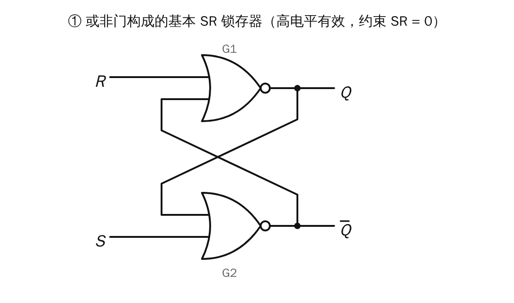
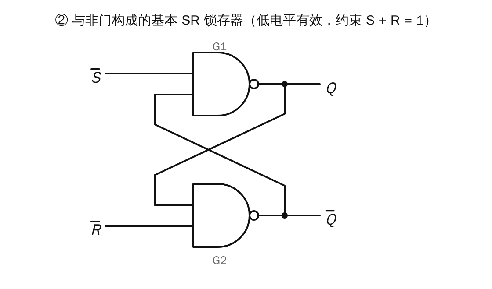
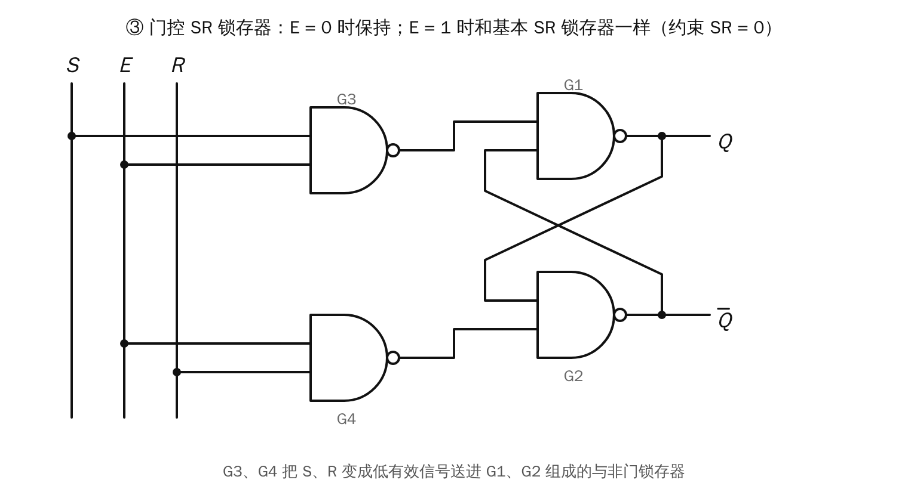
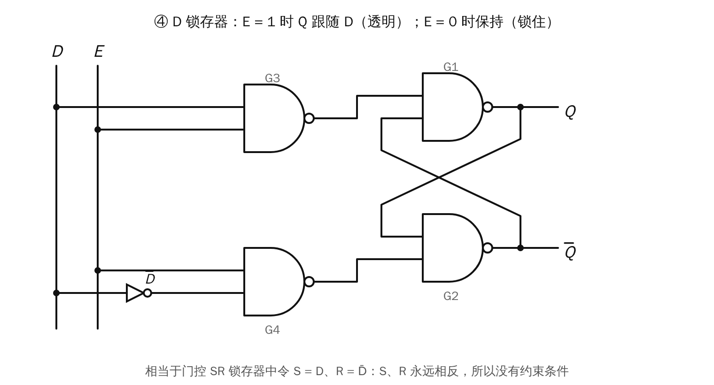
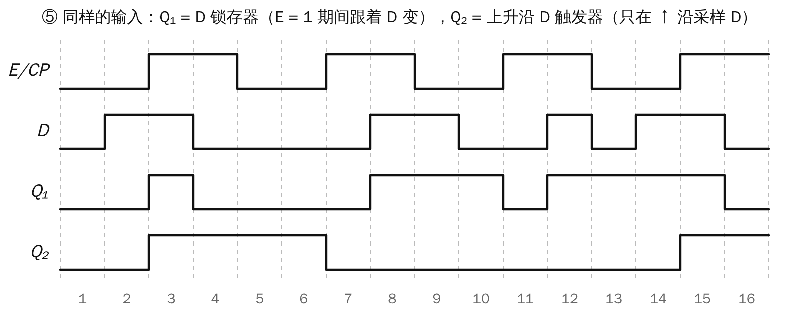

# Lesson 11 配图：锁存器

> 对应课件 11（锁存器和触发器 1）。门用半月形符号画；考试和课件用的是方框形国标符号，两者功能相同。

## ① 或非门构成的基本 SR 锁存器

**怎么看：** 两个或非门的输出交叉接回对方的输入，形成反馈，所以能"记住"状态。

- $Q = \overline{R + \overline{Q}}$
- $\overline{Q} = \overline{S + Q}$

| $S$ | $R$ | $Q^{n+1}$ | 说明 |
|---|---|---|---|
| 0 | 0 | $Q^n$ | 保持 |
| 0 | 1 | 0 | 清 0 |
| 1 | 0 | 1 | 置 1 |
| 1 | 1 | — | 禁止（$Q=\overline{Q}=0$） |

- **高电平有效**，约束条件 $SR=0$。
- 特性方程：$Q^{n+1}=S+\overline{R}\,Q^n$。

## ② 与非门构成的基本 SR 锁存器（低电平有效）

**怎么看：** 与非门"有 0 出 1"。所以 $\overline{S}=0$ 时 $Q$ 立刻变成 1，是置 1；$\overline{R}=0$ 时 $\overline{Q}=1$，即 $Q=0$，是清 0。

| $\overline{S}$ | $\overline{R}$ | $Q^{n+1}$ | 说明 |
|---|---|---|---|
| 0 | 0 | — | 禁止（$Q=\overline{Q}=1$） |
| 0 | 1 | 1 | 置 1 |
| 1 | 0 | 0 | 清 0 |
| 1 | 1 | $Q^n$ | 保持 |

- **低电平有效**，约束条件 $\overline{S}+\overline{R}=1$。
- 判断方法：**看门的类型**。或非门构成的是高有效，与非门构成的是低有效。

## ③ 门控 SR 锁存器

**怎么看：** 前面的 G3、G4 是"闸门"，E 控制闸门开关。
- $E=0$：G3、G4 输出全是 1，G1、G2 锁存器收到 $\overline{S}=\overline{R}=1$，所以**保持**。
- $E=1$：G3 输出 $\overline{S}$，G4 输出 $\overline{R}$，功能和高电平有效的基本 SR 锁存器一样。

| $E$ | $S$ | $R$ | $Q^{n+1}$ | 说明 |
|---|---|---|---|---|
| 0 | × | × | $Q^n$ | 保持 |
| 1 | 0 | 0 | $Q^n$ | 保持 |
| 1 | 0 | 1 | 0 | 清 0 |
| 1 | 1 | 0 | 1 | 置 1 |
| 1 | 1 | 1 | — | 禁止 |

约束条件 $SR=0$ 仍然存在。

## ④ D 锁存器

**怎么看：** 把门控 SR 锁存器的 $S$ 接 $D$，$R$ 接 $\overline{D}$（经过一个非门）。这样 S 和 R 永远相反，不会同时为 1，所以**没有约束条件**。

| $E$ | $Q^{n+1}$ | 说明 |
|---|---|---|
| 0 | $Q^n$ | 保持（锁住） |
| 1 | $D$ | 跟随（透明） |

## ⑤ D 锁存器和 D 触发器的区别

**怎么看：** 两者的输入完全一样，差别只在**什么时候更新**。

- **$Q_1$（D 锁存器，电平触发）**：$E=1$ 的整段时间里，$Q_1$ 跟着 D 变化。例如第 3–4 段，D 先是 1 后是 0，$Q_1$ 也跟着先 1 后 0；第 11–12 段同理。
- **$Q_2$（上升沿 D 触发器，边沿触发）**：只在 CP 上升沿那一瞬间（第 3、7、11、15 段开头）看一眼 D，其余时间 D 怎么变都不理。

这就是第 12 讲要引入触发器的原因：**锁存器在有效电平期间可能翻转多次，触发器每个时钟只翻转一次。**
