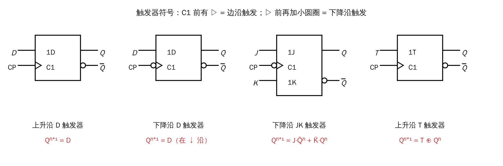
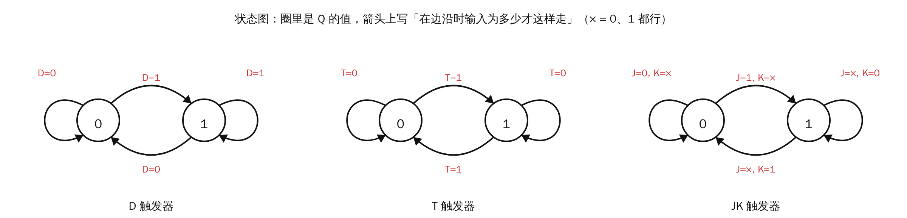
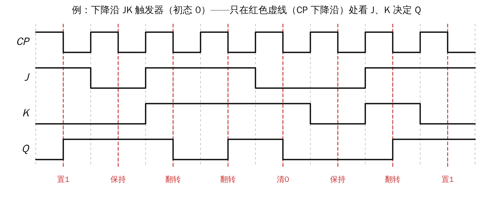
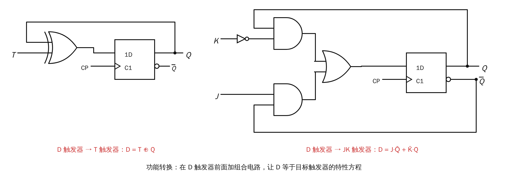

# Lesson 12 配图：触发器

> 对应课件 12（锁存器和触发器 2）。门用半月形符号画，考试用方框形国标符号，功能相同。

## ① 触发器符号与特性方程

- C1 前有 ▷：边沿触发。▷ 前再加小圆圈：**下降沿**触发。
- 只有小圆圈、没有 ▷：低电平有效的**锁存器**，不是触发器。

| 触发器 | 特性方程 | 口诀 |
|---|---|---|
| D | $Q^{n+1}=D$ | 边沿时 D 是几，Q 就变成几 |
| T | $Q^{n+1}=T\oplus Q^n$ | T=1 翻转，T=0 保持 |
| JK | $Q^{n+1}=J\overline{Q^n}+\overline{K}Q^n$ | J 置 1，K 清 0，00 保持，11 翻转 |

## ② 状态图

- 圈里是 Q 的值，箭头上标的是"边沿到来时输入满足什么条件，就这样转移"。
- × 表示取 0、1 都可以。例如 JK 从 0 到 1，只要求 $J=1$，K 取什么都行：K=0 是置 1，K=1 是翻转，结果都变成 1。

## ③ 例题：下降沿 JK 触发器的波形

- 只在红色虚线处（CP 的下降沿）看 J、K，再按口诀决定 Q。
- 两条虚线之间，J、K 怎么变都不影响 Q。

## ④ 功能转换

方法：**让 D 触发器的输入 D 等于目标触发器的特性方程**。

- D → T：$D=T\oplus Q$，用一个异或门。
- D → JK：$D=J\overline{Q}+\overline{K}Q$，用两个与门、一个或门、一个非门。
- JK → D：$J=D$，$K=\overline{D}$；JK → T：$J=K=T$。
