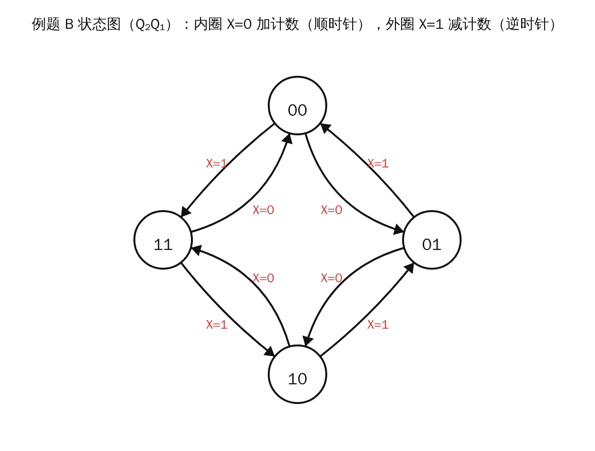
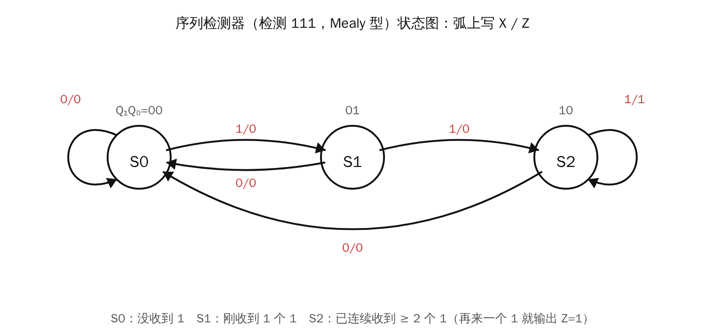
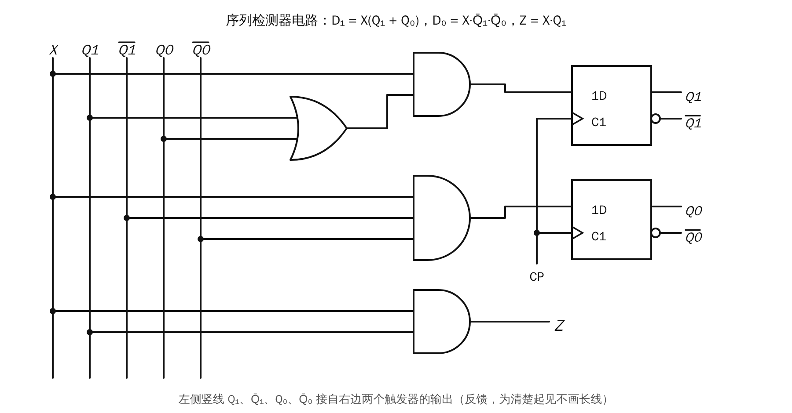

# Lesson 13 + 14 速通：同步时序电路的分析与设计

> 考前速通版：每讲一个**解题模板** + 一道**完整例题**。考试时照着模板一步步写，每步都有分。

---

## 第 13 讲：同步时序电路**分析**（给电路 → 求功能）

### 先认识两种电路

- **同步**：所有触发器接**同一个 CP**，同时翻转。（时钟不共用的叫异步。）
- **Moore 型**：输出只由状态决定，$Y=f(Q)$。状态图里把 Y 写在圈里，如 `Q/Y`。
- **Mealy 型**：输出还直接和输入有关，$Y=f(X,Q)$。状态图里在箭头上写 `X/Y`。

### 分析四步模板

| 步骤 | 要写什么 | 怎么写 |
|---|---|---|
| ① 写方程 | **激励方程**（每个触发器 J、K 或 D 接什么）、**输出方程** | 照电路图读 |
| | **状态方程** | 把激励方程**代入特性方程**（D：$Q^{n+1}=D$；JK：$Q^{n+1}=J\overline{Q}+\overline{K}Q$；T：$Q^{n+1}=T\oplus Q$） |
| ② 列状态表 | 每个现态 →（每种输入下的）次态 / 输出 | 逐行把现态代入状态方程 |
| ③ 画状态图 | 圆圈 = 状态，箭头 = 转移 | 照状态表画；有效循环画在主圈 |
| ④ 说功能 | 几进制计数器？加还是减？序列检测？ | 再看无效状态能不能回到主循环 → **自启动** |

### 例题 A（不带输入）：6.5.8，模 5 计数器

完整解答见 `习题解答/6.5_计数器.md`，里面就是这四步：

- 驱动方程：$J_0=1,K_0=Q_2$；…
- 状态方程；
- 8 行状态表；
- 状态图；
- 结论"模 5，能自启动"。

### 例题 B（带输入 X，改编自课件 13 示例 2）

两个 JK 触发器共用 CP：$J_1=K_1=1$，$J_2=K_2=X\oplus Q_1$。

**① 状态方程**（代入 $Q^{n+1}=J\overline{Q}+\overline{K}Q$；当 $J=K$ 时就是 $Q^{n+1}=J\oplus Q$）：

$$Q_1^{n+1}=\overline{Q_1},\qquad Q_2^{n+1}=X\oplus Q_1\oplus Q_2$$

**② 状态表**（$Q_2Q_1$）：

| 现态 | X=0 时次态 | X=1 时次态 |
|---|---|---|
| 00 | 01 | 11 |
| 01 | 10 | 00 |
| 10 | 11 | 01 |
| 11 | 00 | 10 |

**③ 状态图：**

**④ 功能：** X=0 时 $00\to01\to10\to11\to00$，是加 1 计数；X=1 时倒过来，是减 1 计数。所以这是**模 4 可逆计数器**。4 个状态都在循环里，没有无效状态。

---

## 第 14 讲：同步时序电路**设计**（给要求 → 画电路）

### 设计七步模板

1. **原始状态图**：确定输入、输出；每个状态代表"记住了什么"，按题意画箭头。
2. **状态化简**：如果两个状态在相同输入下输出相同、次态也相同，就是**等价状态**，合并成一个。
3. **状态编码**：M 个状态需要 $n=\lceil\log_2 M\rceil$ 个触发器，一般按顺序编码 00、01、10……
4. **求状态方程和输出方程**：把编码代入状态表，对每个 $Q_i^{n+1}$ 和输出各画一张卡诺图化简。**没用到的编码当无关项 ×**。
5. **检查自启动**：把没用到的编码代入方程，看能不能进入主循环。不能就修改无关项的取法，重新化简。
6. **选触发器，求激励方程**：
   - **D 触发器**：$D=Q^{n+1}$，直接照抄状态方程；
   - **JK 触发器**：把状态方程整理成 $(\ \ )\overline{Q}+(\ \ )Q$ 的形式，前面的括号就是 J，后面括号的反就是 K。
7. **画逻辑图**。

### 例题：检测"111"的序列检测器（课件 14 示例 1，Mealy 型，D 触发器）

**题意**：输入 X 每拍送进 1 位，连续收到三个 1 时输出 Z = 1。

**① ② 状态图**（原始的 S3 和 S2 等价，已合并）：

- S0：没收到 1；
- S1：刚收到 1 个 1；
- S2：已经连续收到 2 个以上的 1。

**③ 编码**：S0 = 00，S1 = 01，S2 = 10，11 没用到。

**④ 状态表 → 方程：**

| $Q_1Q_0$ | X=0 | X=1 |
|---|---|---|
| 00 (S0) | 00 / 0 | 01 / 0 |
| 01 (S1) | 00 / 0 | 10 / 0 |
| 10 (S2) | 00 / 0 | 10 / **1** |
| 11（无效） | × | × |

把 11 当作无关项化简（画卡诺图）：

$$Q_1^{n+1}=X(Q_1+Q_0),\qquad Q_0^{n+1}=X\,\overline{Q_1}\,\overline{Q_0},\qquad Z=XQ_1$$

**⑤ 自启动**：把 11 代入方程。X=0 时次态 00，X=1 时次态 10，都回到了主循环，所以**能自启动**。

**⑥ ⑦ 用 D 触发器**：$D_1=X(Q_1+Q_0)$，$D_0=X\overline{Q_1}\,\overline{Q_0}$。

> 如果题目要求用 JK 触发器：
> - $Q_0^{n+1}=X\overline{Q_1}\cdot\overline{Q_0}+0\cdot Q_0$，所以 $J_0=X\overline{Q_1}$、$K_0=1$；
> - $Q_1^{n+1}=XQ_0\cdot\overline{Q_1}+X\cdot Q_1$，所以 $J_1=XQ_0$、$K_1=\overline{X}$。
